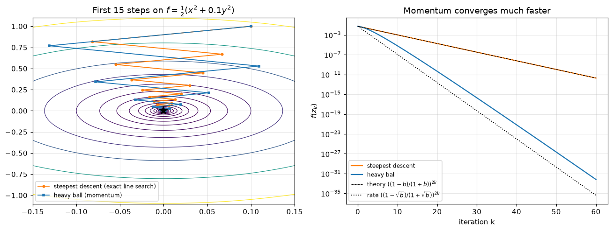
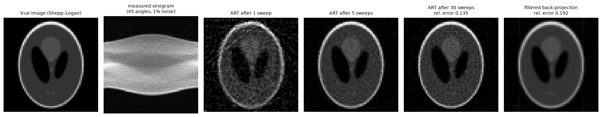
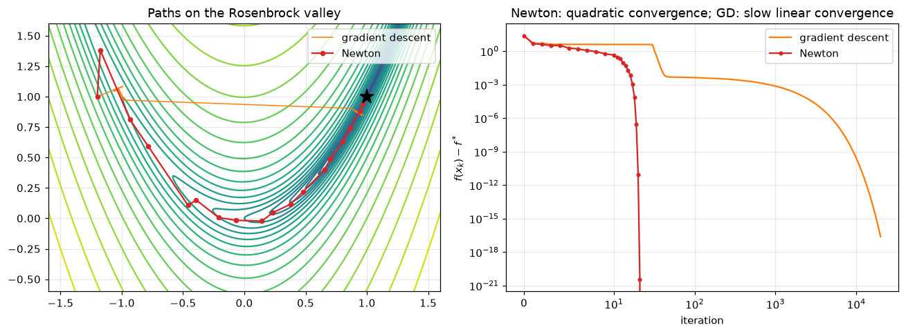
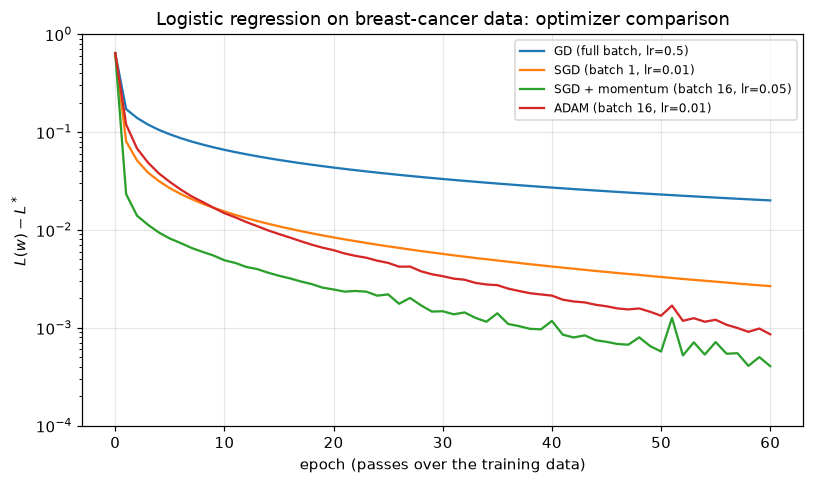
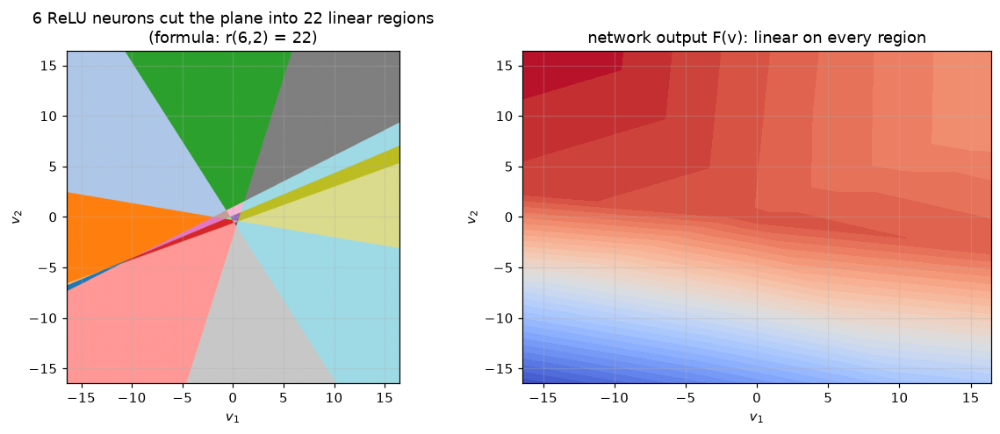
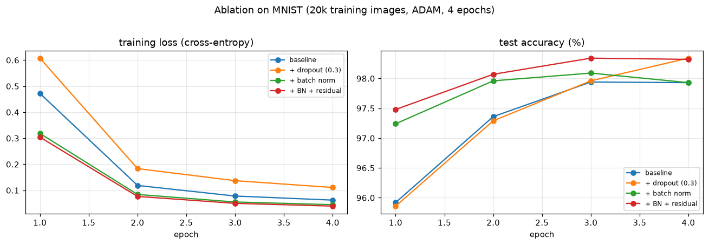

# Some Applications of Data Science: Optimization and Deep Learning

**BS Mathematics thesis** · COMSATS University Islamabad, Department of Mathematics · January 2024
**Author:** Talha Aslam · **Supervisor:** Dr. Salman Amin Malik (Associate Professor)

📄 **[Read the thesis (PDF)](thesis/BS_Thesis_Talha_Aslam_COMSATS.pdf)**

The thesis develops the mathematics behind two pillars of modern data science: **optimization**, which is how models learn, and **deep learning**, which defines what models can represent.
This repository contains the thesis and **companion Jupyter notebooks** that implement and test its main results in Python, from Newton's method and linear-programming duality to SGD, ADAM, CT image reconstruction and convolutional networks.

<p align="center">
  
  
</p>

## Abstract

Modern data science rests on two mathematical pillars: optimization, which drives how models learn, and deep learning, which defines what they can represent. This thesis develops both from first principles, with a focus on how they are used in machine-learning practice.

The first part studies optimization for model training. It covers convexity, Newton's method, Lagrange multipliers, linear and quadratic programming, duality and saddle points, and game theory. It then analyses gradient descent and its convergence, momentum, stochastic gradient descent (SGD), ADAM, and the randomized Kaczmarz method as SGD for large linear systems, with an application to CT image reconstruction.
The second part studies learning from data: loss functions, the bias–variance trade-off, deep neural networks as compositions of piecewise-linear ReLU functions, universal approximation, convolutional neural networks, residual networks, dropout and batch normalization.

## Notebooks

Each notebook maps to a part of the thesis, explains the theory briefly, implements it, and checks the result numerically.

| # | Notebook | Thesis section | What it shows |
|---|---|---|---|
| 01 | [Convexity & Newton's method](notebooks/01_convexity_newton.ipynb) | 1.1 | Hessian test, two local minima of a non-convex function, Newton (22 steps) vs gradient descent (thousands of steps) on the Rosenbrock function, $\ell^1/\ell^2/\ell^\infty$ balls |
| 02 | [Lagrange multipliers, LP, duality, games](notebooks/02_lagrange_lp_games.ipynb) | 1.2 – 1.3 | KKT system, $\partial C/\partial b = -\lambda$ verified numerically, primal/dual LP with complementary slackness, max-flow = min-cut, mixed strategies of zero-sum games via LP |
| 03 | [Gradient descent, zig-zag & momentum](notebooks/03_gradient_descent_momentum.ipynb) | 1.4 | Closed-form zig-zag verified, heavy-ball momentum, iterations growing like $\kappa$ vs $\sqrt\kappa$ |
| 04 | [SGD & ADAM](notebooks/04_sgd_adam.ipynb) | 1.5 | GD, SGD, momentum and ADAM written from scratch, compared on breast-cancer logistic regression; Polyak iterate averaging |
| 05 | [Randomized Kaczmarz & CT](notebooks/05_kaczmarz_ct.ipynb) | 1.5.4 – 1.5.10 | Strohmer–Vershynin convergence bound, the effect of row ordering, CT reconstruction (ART) of the Shepp–Logan phantom vs filtered back-projection |
| 06 | [ReLU networks from scratch](notebooks/06_relu_networks_numpy.ipynb) | 2.0 – 2.1 | Counting linear regions $r(N,2)$, depth vs width ($2^L$ pieces from $2L$ neurons), hand-written backprop (gradient-checked), universal approximation, bias–variance |
| 07 | [CNNs on MNIST](notebooks/07_cnn_mnist.ipynb) | 2.2 | Convolution by hand vs PyTorch, output-size formula, ablation (baseline / dropout / batch norm / residual block), softmax, confusion matrix, learned filters |

## Selected results

| | |
|---|---|
|  |  |
|  |  |

## Run it yourself

```bash
git clone https://github.com/TalhaAslam44/FYP_Some_Applications_of_Data_Science.git
cd FYP_Some_Applications_of_Data_Science
python -m venv .venv
.venv\Scripts\activate          # Windows  (macOS/Linux: source .venv/bin/activate)
pip install -r requirements.txt
jupyter notebook notebooks/
```

All notebooks run on a CPU. Notebook 07 downloads MNIST (about 12 MB) into `data/` on first run and trains for a few minutes. The figures are written to `figures/`.

## Repository structure

```
├── thesis/        BS thesis (PDF)
├── notebooks/     01–07 companion notebooks (executed, with outputs)
├── figures/       plots generated by the notebooks
└── requirements.txt
```

## Note

The thesis (January 2024) is an expository study of the mathematics. The notebooks were added later (2026) as companion implementations of the thesis material.

## Citation

```bibtex
@thesis{aslam2024datascience,
  author = {Talha Aslam},
  title  = {Some Applications of Data Science},
  school = {COMSATS University Islamabad, Department of Mathematics},
  type   = {BS thesis},
  year   = {2024},
  note   = {Supervisor: Dr. Salman Amin Malik}
}
```
